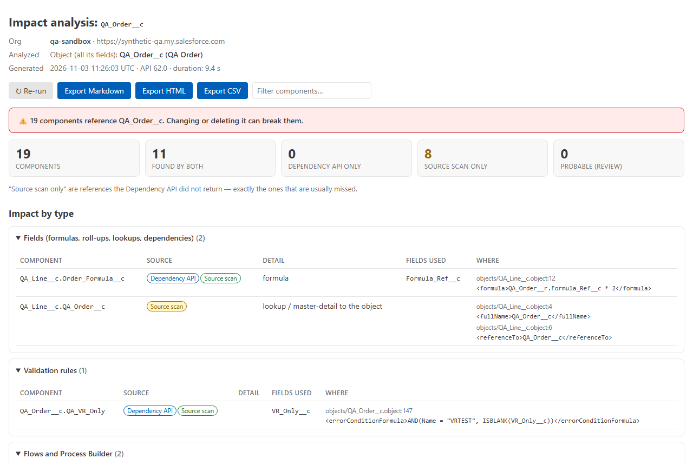
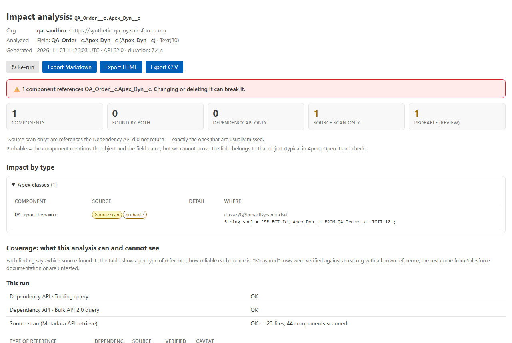
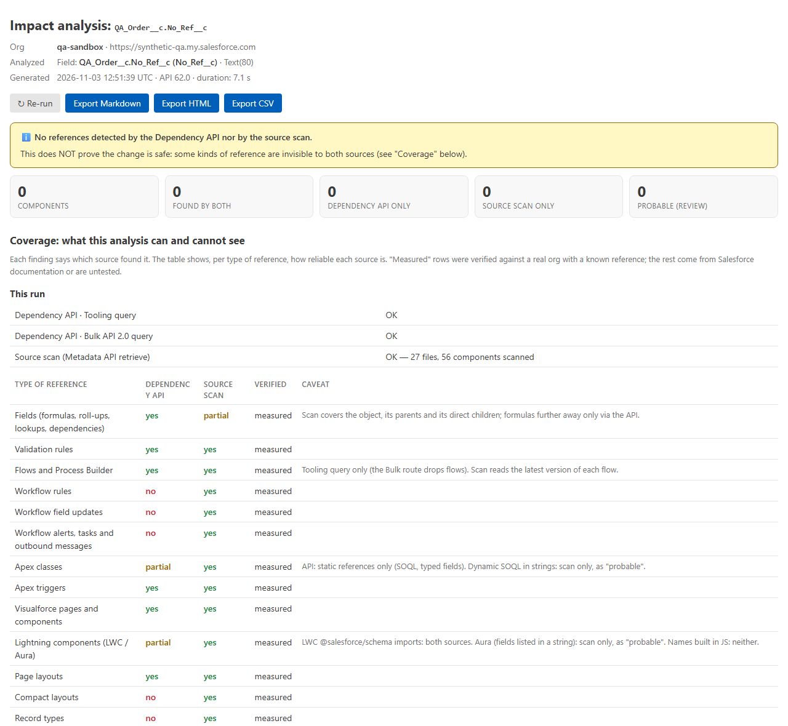
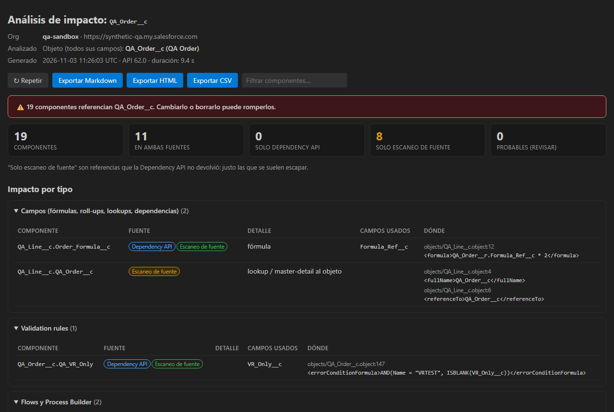

# Salesforce Impact Analyzer – Where Used for QA

**What breaks if I change this field?**

You touch a field and something that looked unrelated breaks: a flow, a validation rule, a formula
on another object, an Apex class, a workflow rule nobody remembered. Salesforce dependencies are
spread out and hidden, and Setup's *"Where is this used?"* button is limited, can't be exported and
misses things.

This extension lists **everything that references a field (or an object)** in your org, the blast
radius, **before** you change it. It groups the results by type, shows **which source found each
one**, and is **honest about what it can't see**.

**100% local · read-only · no backend · no telemetry.** The only network calls are read requests to
your own org, through the Salesforce CLI you already use.



## Two sources, so it doesn't lie about coverage

1. **Dependency API** (Tooling `MetadataComponentDependency`), Salesforce's dependency graph. The
   extension queries it **two ways** (Tooling query + Bulk API 2.0), because in our tests each route
   dropped things the other returned: the Tooling query misses reports, the Bulk route misses flows.
2. **Source scan**: the relevant metadata is retrieved with the Metadata API **in memory** (never
   written to disk) and searched for the field's API name. This is the safety net for what the
   Dependency API never returns.

Every finding is labelled **Dependency API**, **Source scan** or both. Anything found **only by the
scan** is highlighted, because those are the references people usually miss.

### What the Dependency API missed in our tests (and the scan caught)

Measured on a real org with one known reference per type:

| Reference | Dependency API | Source scan |
|---|---|---|
| Validation rule, formula field on another object, Apex (static SOQL), trigger, Visualforce, layout, field set, email template, LWC | ✅ | ✅ |
| Flow (record-triggered and Get Records), custom button/link | ✅ Tooling route only | ✅ |
| Report column, custom report type | ✅ Bulk route only (not available in every org) | ✅ |
| **Workflow rule** / **field update** / **email alert** | ❌ | ✅ |
| **List view**, **record type**, **compact layout**, **quick action layout** | ❌ | ✅ |
| **Dynamic SOQL** in an Apex string, fields listed in an **Aura** component | ❌ | ✅ (marked *probable*) |
| **Standard fields** (e.g. `Account.Industry`) | ❌ (can't be asked) | ✅ |



## What it can't see (it says so in every report)

Every report ends with a **Coverage** section: the status of each source in that run, the
reliability of each source per type of reference (measured / documented / untested), and the list of
things **neither** source can see:

- Field names built at run time (`'Amount' + '__c'`).
- Managed-package code, reports in private folders, dashboards, CRM Analytics.
- References stored as data (custom metadata/settings records, CPQ rules), integrations and anything
  outside the org.
- Profiles and permission sets: left out on purpose, since every field has field-level security.

So **"no references detected" is never presented as "safe to change"**.



## Getting started

1. Install the [Salesforce CLI](https://developer.salesforce.com/tools/salesforcecli) and sign in:
   ```sh
   sf org login web --alias my-sandbox
   ```
2. In VS Code run **Impact Analyzer: Analyze impact of a field or object**. You can start it from
   the Command Palette or the Impact Analyzer icon in the Activity Bar. In an SFDX project you can
   also right-click a `*.field-meta.xml` / `*.object-meta.xml` file.
3. Choose the org, the object, and a field (or **Whole object**).
4. Read the report. Export it to **Markdown, HTML or CSV** and attach it to the ticket
   (*"impact analysis of the change to field X"*).

Typical time: about 10 seconds for a field in a small org, 20–45 seconds in a Developer Edition
with around 1,600 components. Most of that is the metadata retrieve, which runs in parallel with
the Dependency API.

## The report

- Verdict, then counts: total, found by both sources, Dependency API only, **source scan only**,
  and *probable* (for review).
- **Grouped by type**: fields (formulas, roll-ups, lookups, dependent picklists), validation rules,
  flows and Process Builder, workflow rules/field updates/alerts, Apex classes and triggers,
  Visualforce, LWC/Aura, page and compact layouts, record types, list views, field sets, reports,
  report types, email templates, Lightning pages, quick actions, buttons/links, approval processes,
  sharing rules, assignment/escalation rules, duplicate rules, paths.
- For each component: source badges, confidence, detail (*formula*, *inactive*, *Process
  Builder*…), and **where**: file, line and the matching line.
- Analysing a **whole object** also shows which of its fields each component uses.
- English and Spanish.



## Privacy and security

- **Read-only.** The extension sends GET requests, the POST that creates a Bulk API *query* job,
  and the Metadata API `listMetadata` / `retrieve` / `checkRetrieveStatus` calls. Nothing else
  is allowed out. It never deploys, creates, updates or deletes anything.
- **Nothing persisted.** Retrieved metadata is unzipped and scanned **in memory**. Reports reach
  disk only when you export them.
- **No credentials stored.** The session comes from the Salesforce CLI, lives in memory for the
  run, and is never logged or written. The CLI's telemetry is turned off for the calls the extension
  makes.
- **Salesforce domains only.** The session is only ever sent to Salesforce domains; any other host
  is refused and redirects are not followed.
- **No telemetry.** The log (**Impact Analyzer: Show log**) contains counts and timings only.
- Fields you can't see because of field-level security are still analysed (the object model comes
  from the Tooling API, not only from the FLS-filtered describe).

## Settings

| Setting | Default | Description |
|---|---|---|
| `impactAnalyzer.cliPath` | *(empty)* | Path to `sf` if it isn't on your PATH (machine-level setting only) |
| `impactAnalyzer.language` | `auto` | `auto`, `en` or `es` |
| `impactAnalyzer.sourceScan` | `true` | The source scan. Turning it off is faster but leaves workflow rules, list views, record types, dynamic Apex and standard fields uncovered (the report says so) |
| `impactAnalyzer.scanReports` | `true` | Include reports (public folders) in the scan |
| `impactAnalyzer.maxReports` | `5000` | Maximum reports scanned; the report says when the limit was hit |
| `impactAnalyzer.requestTimeoutSeconds` | `120` | Timeout per request |

## Requirements

- VS Code 1.90 or later.
- Salesforce CLI (`sf`) with the org authenticated, and a user with *API Enabled*.
- The source scan uses the Metadata API, which needs *Modify Metadata Through Metadata API
  Functions* or *Modify All Data*; admins have it. Tested with a *Standard User*: the Dependency API
  part works, the scan is refused, and the report says exactly that and what is therefore not
  covered.

## Limits (v1)

- One field or one object per run, direct references only (no chains of dependencies).
- Formulas on objects two or more relationships away are found by the Dependency API only.
- The scan reads the latest version of each flow.

## More Salesforce QA tools

- **[Salesforce Org Parity – Config Diff for QA](https://marketplace.visualstudio.com/items?itemName=AndrsGarcaRamrez.org-parity-salesforce-qa)**: compare config/metadata between two orgs (sandbox vs prod).
- **[Salesforce Migration Validator – Data Reconciliation for QA](https://marketplace.visualstudio.com/items?itemName=AndrsGarcaRamrez.salesforce-migration-validator-qa)**: validate a data migration into Salesforce (CSV vs org, field by field).

---

## En español

**¿Qué se rompe si toco este campo?** Lista todo lo que referencia un campo u objeto de tu org:
flows, validation rules, fórmulas de otros objetos, Apex, workflows, layouts, record types, list
views, reports… Lo agrupa por tipo e indica qué fuente encontró cada cosa: la **Dependency API** de
Salesforce o el **escaneo de fuente** de la metadata. También dice con honestidad qué no puede ver.
Solo lectura y 100% local. Interfaz e informe en español (sigue el idioma de VS Code o el ajuste
`impactAnalyzer.language`).

---

Salesforce is a trademark of Salesforce, Inc. This extension is not affiliated with or endorsed by
Salesforce, Inc.
